

<a href="https://lami.zip/">
  <picture>
    <source media="(prefers-color-scheme: dark)" srcset="assets/header-dark.svg">
    
  </picture>
</a>

  <a href="https://lami.zip/"><picture><source media="(prefers-color-scheme: dark)" srcset="assets/btn-portfolio-dark.svg"></picture></a>
  <a href="https://lami.zip/blog"><picture><source media="(prefers-color-scheme: dark)" srcset="assets/btn-blog-dark.svg"></picture></a>
  <a href="mailto:info@lami.zip"><picture><source media="(prefers-color-scheme: dark)" srcset="assets/btn-mail-dark.svg"></picture></a>
  <a href="https://www.instagram.com/kohnoselami/"><picture><source media="(prefers-color-scheme: dark)" srcset="assets/btn-instagram-dark.svg"></picture></a>

 

<picture>
  <source media="(prefers-color-scheme: dark)" srcset="assets/title-projects-dark.svg">
  
</picture>

  <a href="https://yomi-chan.jp/"><picture><source media="(prefers-color-scheme: dark)" srcset="assets/card-yomi-chan-dark.svg">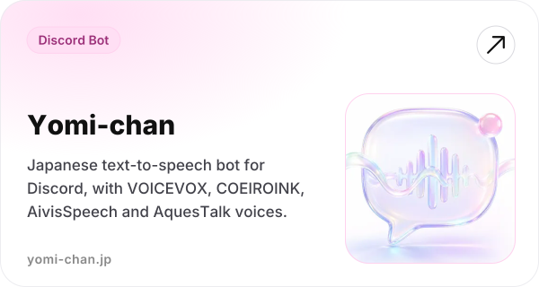</picture></a>
  <a href="https://avennota.lami.zip/"><picture><source media="(prefers-color-scheme: dark)" srcset="assets/card-avennota-dark.svg">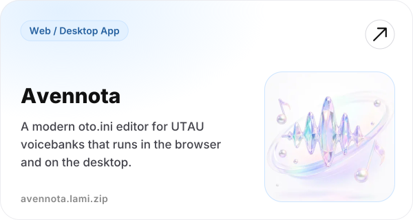</picture></a>
  <a href="https://artifacter.lami.zip/"><picture><source media="(prefers-color-scheme: dark)" srcset="assets/card-artifacter-dark.svg">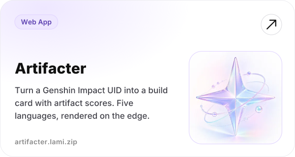</picture></a>
  <a href="https://chromewebstore.google.com/detail/traveler-assistant/nhhfhlllflbgfenfiooogkiljlkbhgjc"><picture><source media="(prefers-color-scheme: dark)" srcset="assets/card-traveler-assistant-dark.svg">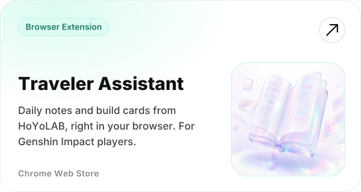</picture></a>
  <a href="https://github.com/Lqm1/x-client-transaction-id"><picture><source media="(prefers-color-scheme: dark)" srcset="assets/card-x-client-transaction-id-dark.svg">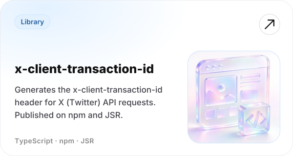</picture></a>
  <a href="https://github.com/Lqm1/pi-codex-app-server"><picture><source media="(prefers-color-scheme: dark)" srcset="assets/card-pi-codex-app-server-dark.svg">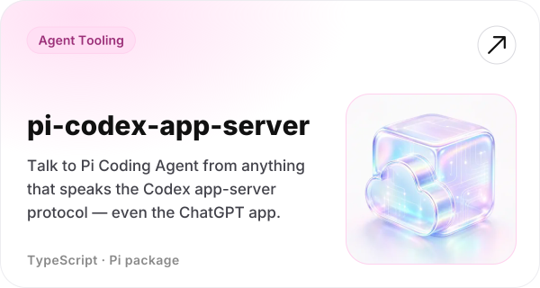</picture></a>

 

<picture>
  <source media="(prefers-color-scheme: dark)" srcset="assets/title-libraries-dark.svg">
  
</picture>

**Speech & singing voice**

- [**shtts-rust**](https://github.com/Lqm1/shtts-rust) — independent Rust reimplementation of the SHTTS speech synthesizer from some Nintendo DS / 3DS titles ([demo](https://lqm1.github.io/shtts-rust/))
- [**ciglet-rs**](https://github.com/Lqm1/ciglet-rs) · [**shiro-rs**](https://github.com/Lqm1/shiro-rs) · [**liblrhsmm-rs**](https://github.com/Lqm1/liblrhsmm-rs) — Rust ports of a signal-processing library, the SHIRO speech toolkit and its HSMM backend, with C ABI and Wasm bindings
- [**AqKanji2Koe-OpenJTalk**](https://github.com/Lqm1/AqKanji2Koe-OpenJTalk) — Japanese text → AquesTalk phonetic notation via jpreprocess
- [**Voicebank2DiffSinger**](https://github.com/Lqm1/Voicebank2DiffSinger) · [**SOFA-oto.ini**](https://github.com/Lqm1/SOFA-oto.ini) — UTAU voicebank → DiffSinger dataset, and automatic `oto.ini` estimation
- [**aquestalk-server**](https://github.com/Lqm1/aquestalk-server) · [**COEIROINK-Dockerfile**](https://github.com/Lqm1/COEIROINK-Dockerfile) — self-hosting for TTS engines

**Web & tooling**

- [**fetch-impersonate**](https://github.com/Lqm1/fetch-impersonate) — standard `fetch` for Node.js on top of libcurl-impersonate
- [**gigafile-mcp**](https://github.com/Lqm1/gigafile-mcp) — MCP server for uploading to / downloading from GigaFile便
- [**openai-workers-ai**](https://github.com/Lqm1/openai-workers-ai) — OpenAI-compatible Whisper API on Cloudflare Workers
- [**hoyolab-auto-sign-bot**](https://github.com/Lqm1/hoyolab-auto-sign-bot) — Discord bot for HoYoLAB daily check-ins, on Workers + D1

 

<picture>
  <source media="(prefers-color-scheme: dark)" srcset="assets/title-stack-dark.svg">
  
</picture>

<picture>
  <source media="(prefers-color-scheme: dark)" srcset="assets/stack-dark.svg">
  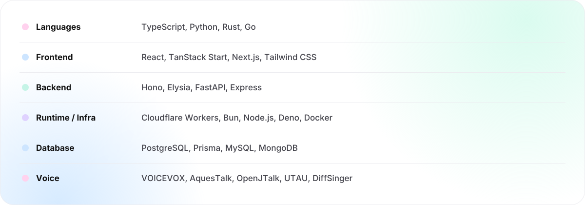
</picture>

  

<picture>
  <source media="(prefers-color-scheme: dark)" srcset="assets/title-hoyoverse-dark.svg">
  
</picture>

Rendered live by <a href="https://artifacter.lami.zip/">Artifacter</a> from my Genshin Impact showcase.

  <a href="https://enka.network/u/895578273/"><picture><source media="(prefers-color-scheme: dark)" srcset="assets/game-genshin-dark.svg">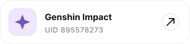</picture></a>
  <a href="https://enka.network/hsr/834466088/"><picture><source media="(prefers-color-scheme: dark)" srcset="assets/game-hsr-dark.svg">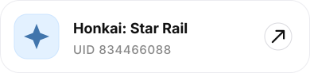</picture></a>
  <a href="https://enka.network/zzz/1311324570/"><picture><source media="(prefers-color-scheme: dark)" srcset="assets/game-zzz-dark.svg">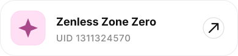</picture></a>

